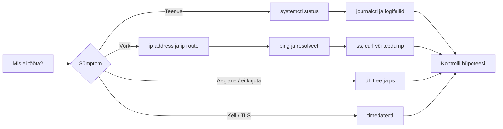

# Linuxi failisüsteem ja käsud

Eestikeelne Linuxi õppeprojekt. [Avalehel](./index.html) on failisüsteemi sissejuhatus ja kaustade tabel. [Linuxi käskude lehel](./linux-kasud.html) on põhikäsud ning SSH ja logide juhend. [Veaotsingu käskude lehel](./veaotsingu-kasud.html#kataloog) on 21 käsku viies tabelis. [Näidisjuhtumite lehel](./naidisjuhtumid.html#juhtumid) on pakiautomaadi tõrked, 404 näide ja kontrollkäigud. [IP-võrkude lehel](./vorgu-alused.html) on IP-aadressi ja alamvõrgu õpetus, binaarkalkulaator ning mõistete tabelid.

## Mida projekt näitab?

- Failisüsteemi sissejuhatus on avalehel ning käsud on eraldi [Linuxi käskude lehel](./linux-kasud.html). Ava [pakiautomaadi näidisjuhtum](./naidisjuhtumid.html#juhtumid): vealogi, sobiv käsk, selle näidisväljund, tõlgendus ja lõpuks põhjendatud järeldus.
- Vali olukord (teenus, võrk, ressursid või kell) ja vaata, millises järjekorras kontrollida.
- Veaotsingu käskude viies tabelis on iga käsu tegevus, kasutusolukord ja osade selgitus kohe näha.
- Kopeeri käsk, asendades enne käivitamist näidisfaili, teenuse, liidese või aadressi oma keskkonna omaga.
- Kõik 21 veaotsingu käsku asuvad [eraldi lehel](./veaotsingu-kasud.html#kataloog); põhikäsud on [Linuxi käskude lehel](./linux-kasud.html). Näidisjuhtumite käsutabel asub [oma lehel](./naidisjuhtumid.html). `tcpdump`i näites on liikluse püüdmine piiratud 20 paketiga.
- [SSH võrgu topoloogia](./vorgu-alused.html#topoloogia) näitab hooldusarvuti ühendusteed läbi avaliku interneti pakiautomaadi Linuxi serverini.
- [VPN-i, netmaski ja gateway konspekt](./vpn-konspekt.html) kuvab kasutaja algse teksti muutmata kujul.
- [Linuxi kaustade pildid](./failisysteem.html) näitavad mõlemat algse PDF-i lehte; [algne PDF](./assets/linux-kaustad-selgitused.pdf) on samuti projektis.
- [Võrguaadresside õppeosa](./vorgu-alused.html) näitab, kuidas aadress seadmele määratakse, kuidas CIDR-prefiksist mask moodustub ning kuidas binaarne AND-tehe annab võrguaadressi. Kalkulaator võrdleb kahte IPv4 aadressi.

Kolm pakiautomaadi juhtumit käsitlevad DNS-i tõrget, täis juurfailisüsteemi ja maas võrguliidest. Logid ning käsuväljundid on väljamõeldud. Nupp „Kuva näidisväljund“ ei käivita midagi seadmes; see näitab, kuidas üks tulemus suunab järgmise kontrollini. Päris seadmes tuleb teenuse nimi, logitee, võrguliides ja aadressid üle kontrollida.

## Veaotsingu kaart



## Käivitamine

Projekt ei vaja sõltuvusi ega ehitustööriistu.

```bash
cd ~/Projects/linux-troubleshooting-tutorial
python3 -m http.server 8000
```

Ava brauseris `http://localhost:8000`. Faili `index.html` võib avada ka otse brauseris. Käsutabelid ja pakiautomaadi juhtumid on õppenäited; leht ei käivita käske sinu arvutis.

Võrgukalkulaatori arvutuste kontrolliks käivita `node tests/network.test.js` (Node.js on vajalik ainult testimiseks).

## GitHub Pages

Projektikaust on juba omaette Git-hoidla. Avaldamiseks loo GitHubis samanimeline tühi hoidla ja saada valmis `main` haru sinna:

```bash
cd ~/Projects/linux-troubleshooting-tutorial
git remote add origin https://github.com/KASUTAJA/linux-troubleshooting-tutorial.git
git push -u origin main
```

Asenda `KASUTAJA` oma GitHubi kasutajanimega. Veebivaate avaldamiseks vali seejärel hoidla seadetes **Pages → Deploy from a branch → main → /(root)**.

## Ohutu harjutamine

Enamik käske loeb olekut. `ping`, `curl`, `ssh` ja `tcpdump` suhtlevad võrgu või võrguliidesega; kasuta vaid lubatud sihtkohti ja püüa pakette ainult võrgus, kus sul on selleks õigus. `tcpdump` võib vajada kõrgemaid õigusi. Näidisaadressid `example.com`, `1.1.1.1` ja `192.168.10.1`, teenus `example.service`, liides `eth0` ning logifail `example.log` tuleb vastavalt olukorrale asendada. `ssh` näide viitab [OverTheWire Banditi 0. tasemele](https://overthewire.org/wargames/bandit/bandit0.html).

## Visuaalse arenduse ideed

1. **Otsustuspuu:** küsimused „kas teenus töötab?“, „kas IP on olemas?“, „kas DNS lahendab?“ juhatavad järgmise käsuni.
2. **Väljundi anatoomia:** klõpsatav näidisväljund tõstab esile olulised väljad, näiteks `default via`, `LISTEN` või `available`.
3. **Harjutusrežiim:** fiktiivne tõrge ja mitu võimalikku järgmist käsku; vastuse järel selgitus, miks see sobib.
4. **Mõõdikute ajajoon:** CPU, mälu ja kettaruumi näidised seotakse sama ajavahemiku logikirjetega.

Projekt on õppematerjal. Enne päris süsteemis käivitamist kontrolli käsu sihtkohta ja õigusi.
