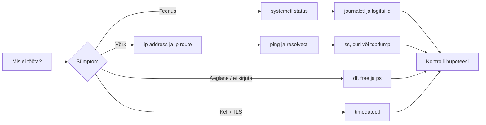

# Linuxi veaotsingu atlas

Väike eestikeelne õppeprojekt, mis seob 21 Linuxi käsku praktilise veaotsingu järjekorraga. [Ava interaktiivne vaade](./index.html) või loe [käskude selgitusi](./docs/kasud.md).

## Mida projekt näitab?

- Vali olukord (teenus, võrk, ressursid või kell) ja vaata, millises järjekorras kontrollida.
- Otsi käsku nime või märksõna järgi; ava kaardil selle osad ja kasutusjuht.
- Kopeeri käsk, asendades enne käivitamist näidisfaili, teenuse, liidese või aadressi oma keskkonna omaga.
- Kõik 21 käsku on dokumenteeritud. `tcpdump`i näites on liikluse püüdmine piiratud 20 paketiga.

## Veaotsingu kaart



## Käivitamine

Projekt ei vaja sõltuvusi ega ehitustööriistu.

```bash
cd linux-veaotsingu-atlas
python3 -m http.server 8000
```

Ava brauseris `http://localhost:8000`. Faili `index.html` võib avada ka otse brauseris. Kaardid on õppenäited; leht ei käivita käske sinu arvutis.

## GitHub Pages

Projektikaust on juba omaette Git-hoidla. Avaldamiseks loo GitHubis samanimeline tühi hoidla ja saada valmis `main` haru sinna:

```bash
cd linux-veaotsingu-atlas
git remote add origin https://github.com/KASUTAJA/linux-veaotsingu-atlas.git
git push -u origin main
```

Asenda `KASUTAJA` oma GitHubi kasutajanimega. Veebivaate avaldamiseks vali seejärel hoidla seadetes **Pages → Deploy from a branch → main → /(root)**.

## Ohutu harjutamine

Enamik käske loeb olekut. `ping`, `curl`, `ssh` ja `tcpdump` suhtlevad võrgu või võrguliidesega; kasuta vaid lubatud sihtkohti ja püüa pakette ainult võrgus, kus sul on selleks õigus. `tcpdump` võib vajada kõrgemaid õigusi. Näidisaadressid `example.com`, `1.1.1.1` ja `192.168.10.1`, teenus `example.service`, liides `eth0` ning logifail `example.log` tuleb vastavalt olukorrale asendada. `ssh` näide viitab [OverTheWire Banditi 0. tasemele](https://overthewire.org/wargames/bandit/bandit0.html).

## Visuaalse arenduse ideed

1. **Otsustuspuu:** küsimused „kas teenus töötab?“, „kas IP on olemas?“, „kas DNS lahendab?“ juhatavad järgmise käsuni.
2. **Väljundi anatoomia:** klõpsatav näidisväljund tõstab esile olulised väljad, näiteks `default via`, `LISTEN` või `available`.
3. **Harjutusrežiim:** fiktiivne tõrge ja mitu võimalikku järgmist käsku; vastuse järel selgitus, miks see sobib.
4. **Mõõdikute ajajoon:** CPU, mälu ja kettaruumi näidised seotakse sama ajavahemiku logikirjetega.

Projekt on õppematerjal. Enne päris süsteemis käivitamist kontrolli käsu sihtkohta ja õigusi.
